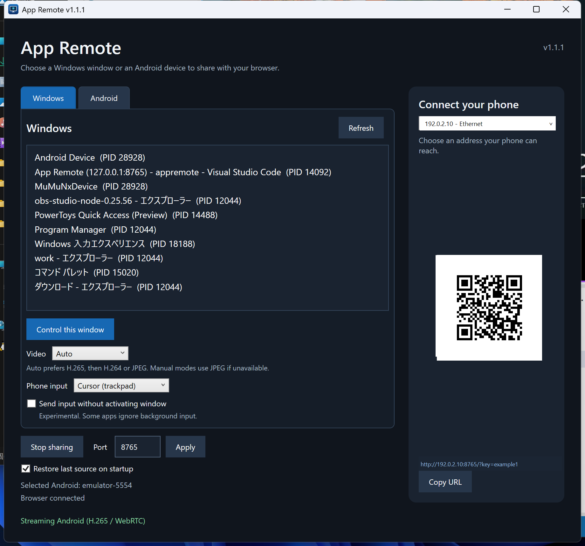
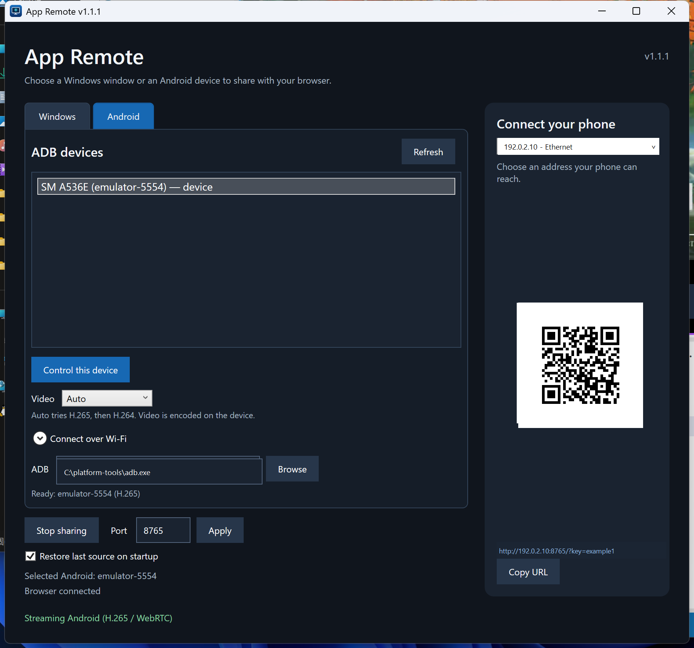

# App Remote

App Remote lets you view and control one selected Windows window or Android device from a phone or PC browser on the same local network or over a Tailscale tailnet. Select the source in the Windows app, then open the QR code in Safari on iPhone, Chrome on Android, or a PC browser. No browser-side app is required.

Windows video uses H.265 or H.264 over WebRTC when available, with JPEG over WebSocket as a fallback. Android video is encoded on the device and sent over WebRTC without PC re-encoding. The Windows app shows which video transport is active.

## Screenshots

| Windows source settings | Android source settings |
| --- | --- |
|  |  |

The QR code, connection address, and ADB path shown in these screenshots are examples.

## Download

Download the Windows x64 ZIP from the [latest release](https://github.com/asaday/AppRemote/releases/latest). Extract the whole `AppRemote` folder and run `AppRemote.exe`. The release includes the .NET runtime, so the .NET SDK is not needed to run it.

## Features

- Select an eligible Windows window or an ADB-connected Android device to stream
- Tap, drag, scroll, and type from a phone or PC browser
- Choose direct touch or relative cursor control in the Windows app
- Optionally send input to the selected window without bringing it to the foreground (experimental)
- Connect with a QR code or the **Copy URL** button
- Add a shortcut with an icon to the iPhone Home Screen
- One active browser connection at a time; a newer connection takes over, and the previous page retries every five seconds until the connection is free
- When no browser is connected, the selected Windows window stays remembered without capture or JPEG encoding, and the Android encoder stops until the next connection
- Choose Auto, H.265, H.264, or JPEG for Windows video; Auto, H.265, or H.264 for Android video

## Requirements

- Windows 10 version 2004 or later, or Windows 11 (x64)
- A phone or PC browser on the same local network, or devices connected to the same Tailscale tailnet (Safari on iPhone or Chrome on Android)
- [FFmpeg (Shared) 8.1](https://github.com/GyanD/codexffmpeg/releases/tag/8.1) for Windows H.265/H.264 video

Without FFmpeg, the app can still stream JPEG frames. On Windows, you can install the shared FFmpeg build with:

```powershell
winget install --id Gyan.FFmpeg.Shared --version 8.1 --exact
```

To share an Android device, install [Android SDK Platform Tools](https://developer.android.com/tools/releases/platform-tools) on the Windows PC and enable USB debugging or wireless debugging on the device. App Remote finds `adb.exe` in Platform Tools or on `PATH`; you can also select it with **Browse** in the Android tab. The app downloads the scrcpy device server from its official release on first use and verifies its SHA-256 checksum. This first start needs internet access. You do not need the scrcpy desktop app or an Android companion app.

## Build and run

Install the [.NET 10 SDK](https://dotnet.microsoft.com/download/dotnet/10.0), then run this from the repository root:

```powershell
.\build.ps1
```

This publishes the app to `dist/AppRemote/`. The equivalent command is:

```powershell
dotnet publish src/AppRemote/AppRemote.csproj -c Release -r win-x64 --self-contained false -o dist/AppRemote
```

This local build requires the [.NET 10 Desktop Runtime and ASP.NET Core Runtime](https://dotnet.microsoft.com/download/dotnet/10.0) on the PC that runs it. The .NET 10 SDK includes both.

Exit App Remote from its system tray menu before rebuilding it. To move the app to another PC, copy the entire `dist/AppRemote/` directory, not only `AppRemote.exe`.

1. Start `dist/AppRemote/AppRemote.exe`.
2. If Windows Firewall prompts you, allow access on **private networks**.
3. Select a source in the **Windows** or **Android** tab and click **Control this window** or **Control this device**.
4. Open the QR code on a phone connected to the same network. You can also use **Copy URL** and open the address manually.
5. Click **Stop sharing** to end the selected source. The connection page stays available so you can select another source.

Minimizing or closing the Windows window hides it in the system tray while the server and selected window remain active. Double-click the tray icon to reopen the window. The tray menu has **Open App Remote**, **Stop sharing**, **Keep streaming after RDP**, and **Exit**; select **Exit** to shut down the server.

Enable **Restore last source on startup** to resume the previous Windows window or Android device when it is available at launch. **Stop sharing** clears the remembered source. The setting is stored for the current Windows user.

Use the Windows app's **Video** menu to choose the transport. **Auto** prefers H.264, then H.265 if H.264 is unavailable, then JPEG. Choose **H.265** explicitly when you want higher compression and the PC can encode it reliably. **H.265** and **H.264** request a specific WebRTC codec and fall back to JPEG if it cannot start. **JPEG** uses WebSocket without WebRTC. Changes apply to the connected browser and the choice is saved for the current Windows user.

## Android source

Open the **Android** tab and click **Refresh**. Devices already connected through ADB, including USB and paired wireless devices, appear in the list. Select a device with state **device**, then click **Control this device**. Other states such as **unauthorized** require approval on the Android device.

For a wireless connection, expand **Connect over Wi-Fi**. Enter the connection IP:port and click **Connect**. Android 11 or newer may first require **Pair** with the pairing IP:port and six-digit code shown in the device's Wireless debugging screen. The pairing port and connection port can differ. [Android's ADB guide](https://developer.android.com/tools/adb) explains the setup.

Android **Video** offers **Auto**, **H.265**, and **H.264**. Auto tries H.264 first, then H.265 if H.264 is unavailable. Choose H.265 explicitly when you want higher compression and the device can encode it reliably. The Android encoder has a 4 Mbps target bitrate, shown in the Windows app. Windows video uses the encoder's default bitrate without a fixed target. The device does the Android encoding; App Remote forwards the compressed video to WebRTC. Android currently requires WebRTC video and does not have a JPEG fallback. Touch, drag, scroll, and keyboard input use scrcpy's device control channel.

The server uses TCP port `8765` by default. To change it, enter a number from 1 to 65535 in the Windows app's **Port** field and select **Apply**. The server restarts on the new port, the URL and QR code update, and connected browsers must open the new URL. The port is saved for the current Windows user. WebRTC video also uses UDP. On iPhone, use Safari's **Add to Home Screen** action to launch from an icon. If an existing shortcut keeps an old icon, remove it and add it again.

## Outside your LAN with Tailscale

Install and connect [Tailscale](https://tailscale.com/download) on both the Windows PC and phone, using the same tailnet. Start App Remote while Tailscale is connected, then choose the IP address shown for the Tailscale network interface in the PC's address menu. The QR code and **Copy URL** button use the selected address. Open that URL on the phone with Tailscale connected; no router port forwarding is needed. If Tailscale was started after App Remote, restart App Remote to refresh the address list.

The address menu also lists other active IPv4 addresses on the PC. Choose the address reachable from your phone when the PC has multiple network connections.

Tailscale assigns each device a stable IP address. You can also find the PC's address with `tailscale ip -4` or in the Tailscale app. The pairing key is the same for the LAN and Tailscale URLs, so you can save the Tailscale URL to the phone's Home Screen for use away from home. [Tailscale's IP address guide](https://tailscale.com/kb/1033/ip-and-dns-addresses/) explains how these addresses work.

## Phone controls

For a Windows source, use the Windows tab's **Phone input** menu to choose **Direct touch** or **Cursor (trackpad)**. The choice is saved on the PC and updates the connected phone. **Direct touch** taps the point shown on screen and supports dragging. **Cursor** moves the Windows pointer relative to your finger; a tap clicks at the pointer's current position. Use Direct touch to drag an item. Android uses direct touch.

Enable **Send input without activating window** in the Windows app to try background control. This sends mouse and keyboard messages to the selected window instead of moving the PC's physical cursor or activating the window. In Cursor mode, a small marker on the phone shows the virtual pointer. The choice is saved on the PC and updates the connected phone. Turn the checkbox off to return to normal input.

| Gesture | Windows input |
| --- | --- |
| Tap | Left click at the touched point (Direct) or pointer position (Cursor) |
| Drag | Hold and move the left mouse button (Direct) or move the pointer (Cursor) |
| Long press | Right click at the touched point (Direct) or pointer position (Cursor) |
| Move two fingers vertically | Scroll |
| Tap with two fingers | Open the keyboard |

The video keeps the window's aspect ratio. Black margins are outside the control area.

On a PC browser, moving the mouse over the image moves the target cursor in normal input mode. You can also click, drag, right click, and scroll. Type directly with the keyboard; text and the listed navigation keys are forwarded. When the browser and target app run on the same PC, input brings the target app forward, so the browser loses keyboard focus.

## Connection and limitations

- If you start App Remote in a Remote Desktop (RDP) session, a normal RDP disconnect can freeze window capture. Before disconnecting, use **Keep streaming after RDP** in the Windows tray menu and approve the administrator prompt. This hands the running desktop to the console and disconnects RDP; App Remote and the selected window keep running. Do not sign out. Reconnecting with RDP moves the desktop back to the remote session. The menu item requires permission to connect to the console session. The equivalent command from an elevated Command Prompt is `tscon <ID> /dest:console`, where `query session` shows the RDP session ID.
- The eight-character key in the connection URL stays the same across restarts. URLs using the older, longer key remain valid. If the PC's LAN IP address changes, scan the LAN QR code again to get a new URL.
- The secret used to derive the key is stored at `%LOCALAPPDATA%\AppRemote\pairing.key` for the current Windows user.
- Capture continues when the selected window is behind another window. Normal input brings the selected window to the foreground first. If Windows denies that focus change, normal input cannot be delivered.
- Background control is experimental. It can work with ordinary Windows controls, but applications that require focus, read raw input, or run elevated may ignore the posted messages. It targets the window's client area; title-bar controls are not supported. Windows also blocks [posting messages](https://learn.microsoft.com/en-us/windows/win32/api/winuser/nf-winuser-postmessagew) to a higher-integrity process.
- Elevated windows, UAC prompts, and minimized windows are outside the supported control path. Some apps may have a small offset between the captured image and pointer coordinates.
- The connection page and control channel use HTTP and WebSocket over the LAN or tailnet. Anyone with the connection URL and network access can control the selected window, so use App Remote on a trusted private network or tailnet. Chrome on Android may not offer full PWA installation for an HTTP page.

## Development check

Run the integration check in an active Windows desktop session with TCP port `18765` free. It opens an animated test window:

```powershell
dotnet run --project tests/CaptureSmoke/CaptureSmoke.csproj
```

It checks web and icon delivery, key authentication, foreground and background input, JPEG/WebSocket frames, and H.264/H.265 WebRTC frames. Check phone rendering and interaction on a device separately.

To check browser handoff without opening a test window, run `dotnet run --project tests/CaptureSmoke/CaptureSmoke.csproj -- --handoff-only` with TCP port `18766` free.

To check that window capture pauses without browsers and resumes on connection, run `dotnet run --project tests/CaptureSmoke/CaptureSmoke.csproj -- --idle-only` with TCP port `18767` free.

With an ADB-connected Android device, run the Android integration check:

```powershell
dotnet run --project tests/AndroidSmoke/AndroidSmoke.csproj -- C:\path\to\adb.exe DEVICE_SERIAL
```

It checks H.264 and H.265 video from the device through the App Remote WebRTC server and sends one Tab key event to verify the control channel.

To check that Android encoding starts on connection and stops on disconnect using H.264 only, add `--idle-only` after the device serial. This check uses TCP port `18768`.
